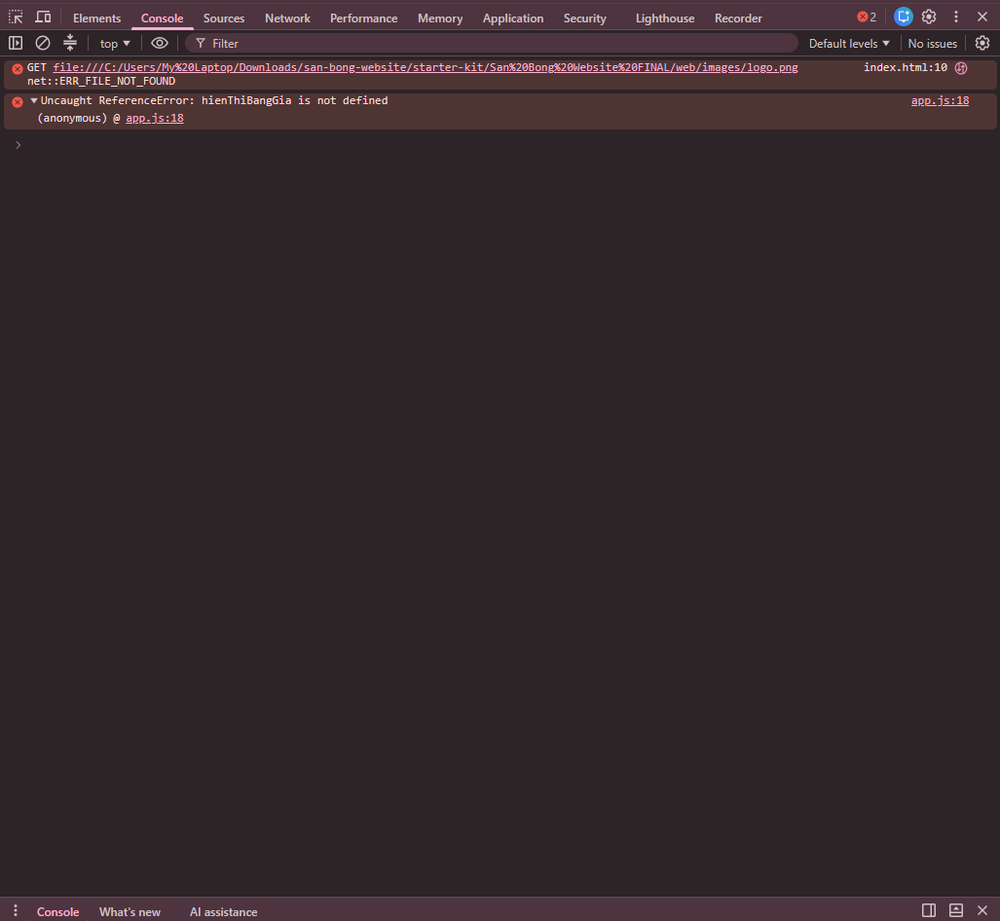
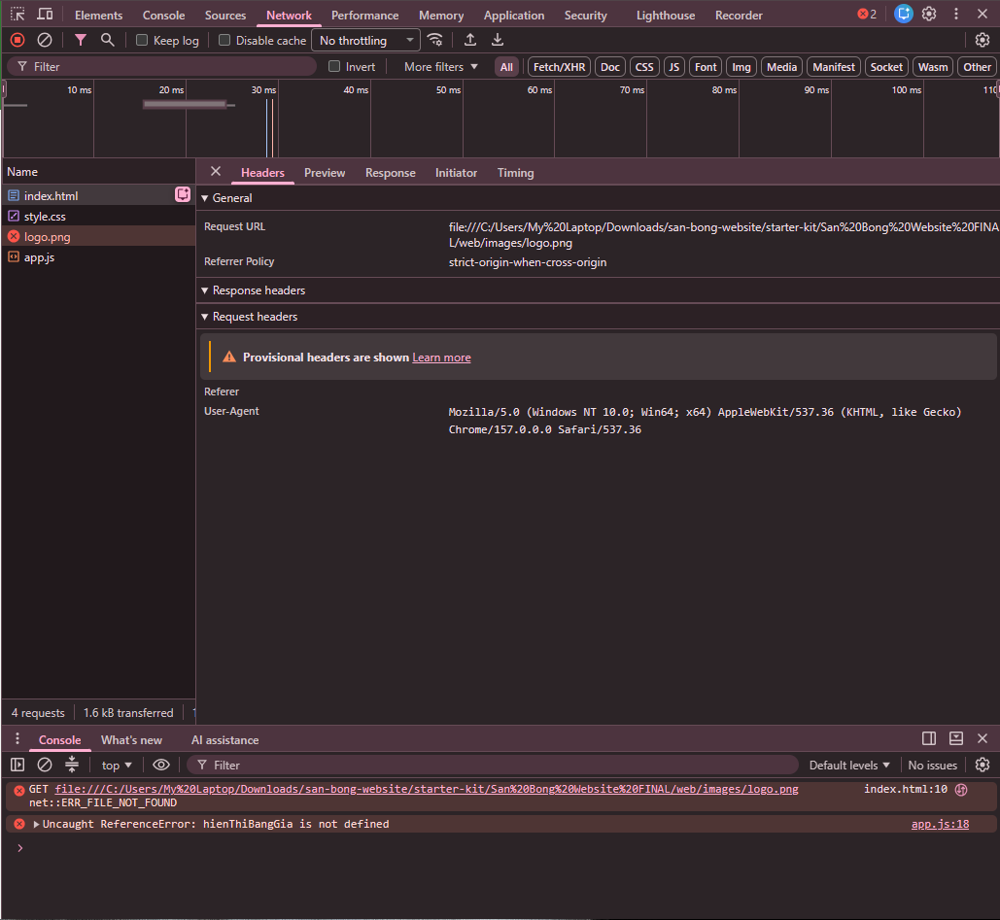

# BÀI LÀM – HACKATHON 02

- **Mã đề:** 01
- **Họ tên:**
- **Lớp:**
- **Link repository:**
- **Hệ điều hành (Windows/macOS):**

## 4.2. Thao tác máy tính cơ bản bằng CLI

### Các lệnh đã chạy

```
pwd
gci -recurse -force
mv .\ghi_chu_ban_giao.txt .\docs\
cp .\data\dat_san_thang_10.xlsx .\backup\
rm *.tmp
cd .\logs\; gc access.log; cd ..
```

### Kết quả liệt kê toàn bộ dự án (Windows: Get-ChildItem -Recurse -Force; macOS: ls -aR)

```
    Directory: C:\Users\My Laptop\Downloads\san-bong-website


Mode                 LastWriteTime         Length Name
----                 -------------         ------ ----
d-----          10/11/26   7:10 AM                data
d-----          10/11/26   7:08 AM                docs
d-----          10/11/26   7:09 AM                evidence
d-----          10/11/26   7:11 AM                logs
d-r---          04/11/26   4:11 PM                starter-kit
-a----          04/11/26   4:11 PM             76 .env
-a----          04/11/26   4:11 PM           2409 bai_lam.md
-a----          04/11/26   4:11 PM            154 ghi_chu_ban_giao.txt
-a----          04/11/26   4:11 PM        2688235 Luyen_tap.docx
-a----          04/11/26   4:11 PM             22 temp_002.tmp
-a-h--          10/11/26   7:08 AM            162 ~$yen_tap.docx


    Directory: C:\Users\My Laptop\Downloads\san-bong-website\data


Mode                 LastWriteTime         Length Name
----                 -------------         ------ ----
-a----          04/11/26   4:11 PM           6074 dat_san_thang_10.xlsx


    Directory: C:\Users\My Laptop\Downloads\san-bong-website\logs


Mode                 LastWriteTime         Length Name
----                 -------------         ------ ----
-a----          04/11/26   4:11 PM            956 access.log


    Directory: C:\Users\My Laptop\Downloads\san-bong-website\starter-kit


Mode                 LastWriteTime         Length Name
----                 -------------         ------ ----
d-r---          10/11/26   7:12 AM                San Bong Website FINAL
-a----          04/11/26   4:11 PM           2409 bai_lam.md


    Directory: C:\Users\My Laptop\Downloads\san-bong-website\starter-kit\San Bong Website FINAL


Mode                 LastWriteTime         Length Name
----                 -------------         ------ ----
d-r---          04/11/26   4:11 PM                web


    Directory: C:\Users\My Laptop\Downloads\san-bong-website\starter-kit\San Bong Website FINAL\web


Mode                 LastWriteTime         Length Name
----                 -------------         ------ ----
d-r---          04/11/26   4:11 PM                images
-a----          04/11/26   4:11 PM            590 app.js
-a----          04/11/26   4:11 PM            529 index.html
-a----          04/11/26   4:11 PM            460 style.css


    Directory: C:\Users\My Laptop\Downloads\san-bong-website\starter-kit\San Bong Website FINAL\web\images


Mode                 LastWriteTime         Length Name
----                 -------------         ------ ----
-a----          04/11/26   4:11 PM           3101 logo-san-bong.png

```

## 4.3. Lọc log truy cập website

### a) Lệnh lọc các dòng status=500

```
 gc .\logs\access.log | Select-String "status=500" >>.\logs\loi_500.txt

```

### 2 dòng đầu tiên trong logs/loi_500.txt

```
2026-10-28 08:24:34 POST /api/thanh-toan status=500
2026-10-28 08:28:45 POST /api/thanh-toan status=500

```

### b) Lệnh đếm số dòng status=404 và kết quả

```
gc .\logs\access.log | Select-String "status=404" | Measure-Object

```

```

Count    : 4
Average  :
Sum      :
Maximum  :
Minimum  :
Property :

```

## 4.4. Chạy script tong_hop (.ps1 hoặc .sh)

### Lệnh chạy (Windows: nếu dùng Phụ lục 2 thì ghi cả 2 lệnh)

```
Set-ExecutionPolicy Bypass -Scope Process
.\tong_hop.ps1 

```

### Nội dung file logs/tong_hop.txt

```
=== BAO CAO SU CO WEBSITE ===

2026-10-28 08:07:39 GET /tin-tuc status=404
2026-10-28 08:13:01 GET /dat-san-cu status=404
2026-10-28 08:34:07 GET /images/san-7.jpg status=404
2026-10-28 08:57:24 GET /khuyen-mai status=404


Count    : 6
Average  : 
Sum      : 
Maximum  : 
Minimum  : 
Property : 


```

## 4.5. README.md và bảo vệ thông tin bí mật

> README.md, .gitignore và .env.example được chấm trực tiếp trên file ở gốc dự án. Đánh dấu `[x]` vào các mục đã làm để tự kiểm tra.

- [x] README.md: Heading 1, mô tả có **in đậm** và *in nghiêng*, bảng, code block, task list, blockquote
- [x] .gitignore có dòng `.env` (tên file đúng, không có đuôi .txt)
- [x] .env.example có đủ tên biến, giá trị để trống (tên file đúng, không có đuôi .txt)

## 4.6. Kiểm tra trang web bằng DevTools (F12) và báo cáo lỗi

### Bảng lỗi

| STT | Tab DevTools phát hiện lỗi | Tên file hoặc thông báo lỗi | Cách khắc phục |
| --- | --- | --- | --- |
| 1 |Tab Network |file:///C:/Users/My%20Laptop/Downloads/san-bong-website/starter-kit/San%20Bong%20Website%20FINAL/web/images/logo.png  |sử dụng VSC vào file index.html chỉnh   |
| 2 |Tab Console |app.js:18 Uncaught ReferenceError: hienThiBangGia is not defined(anonymous)	@	app.js:18 |sử dụng VSC vào file app.js chỉnh hienThiBangGia(); sang hienThiBangGiaSan(); |
> Ảnh chụp màn hình lưu trong thư mục `evidence/` (network.png, console.png).



### Báo cáo lỗi gửi trưởng nhóm

- **Context:** Tôi không tự sửa được lỗi ở Tab Console và cần được trưởng nhóm hỗ trợ.
- **Expected:** Các bạn có thể giúp tôi sửa được lỗi này được không.
- **Actual:** Thử các cách khác nhau nhưng vẫn bị lỗi.
- **Log:** Lỗi ở trong Console: "app.js:18 Uncaught ReferenceError: hienThiBangGia is not defined(anonymous)	@	app.js:18"

### Câu tìm kiếm Google

```
"app.js:18 Uncaught ReferenceError: hienThiBangGia is not defined(anonymous)	@	app.js:18" site:stackoverflow.com
```

## 4.7. Excel

> Phần Excel được chấm trực tiếp trên file `data/dat_san_thang_10.xlsx`, không cần ghi vào đây.
